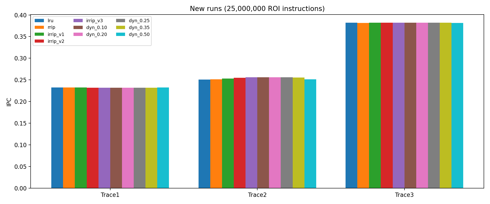
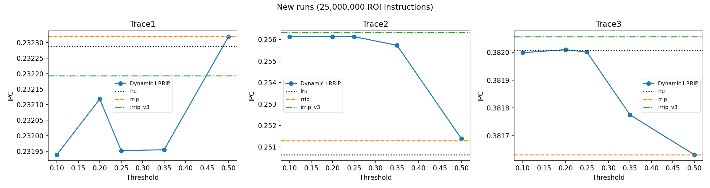
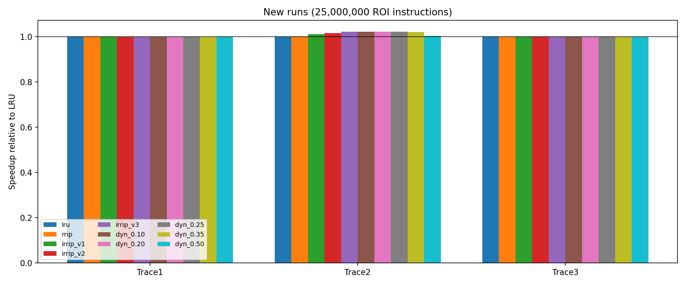
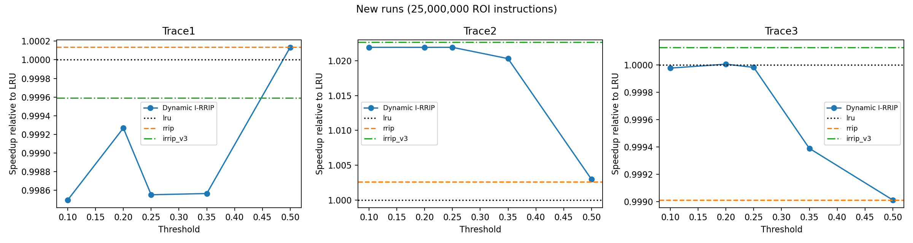
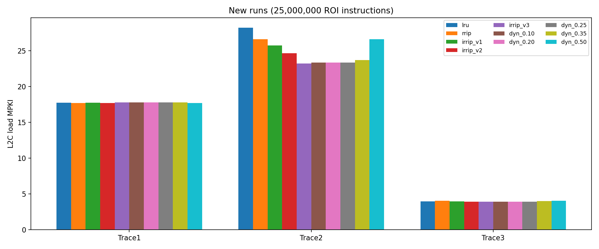
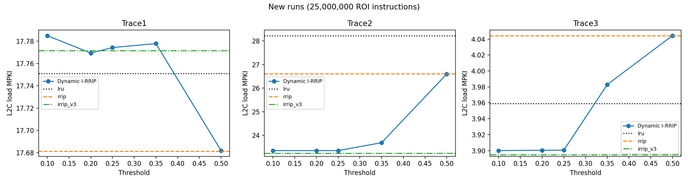
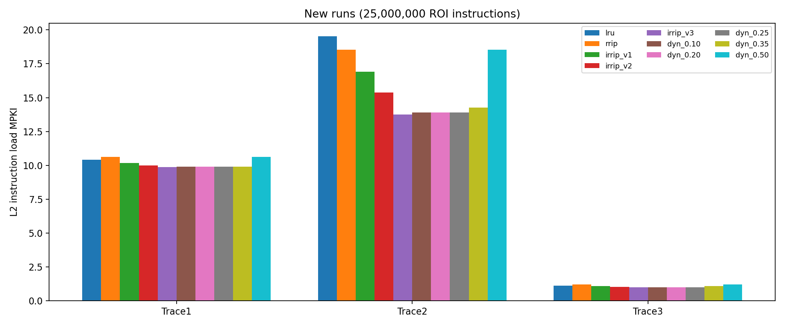
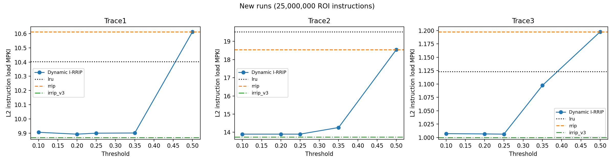
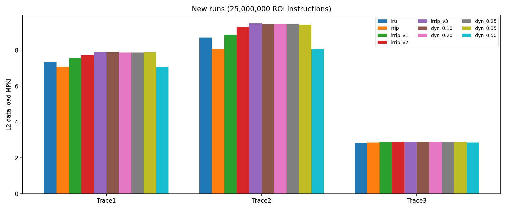
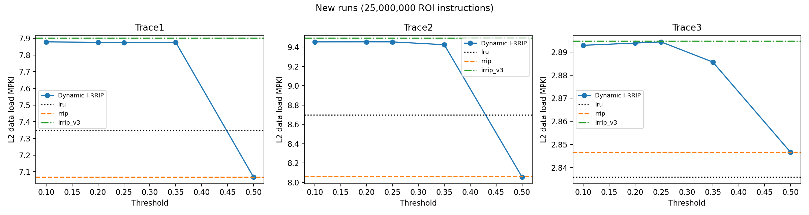

# CS683 PA2 Task 2 report

**Status: the required full experiment matrix is complete.** All report measurements below come from the single retained run `results/task2_full_20261015T014645Z_z4ffcl21`. The teammate generated these measurements; they were independently re-parsed during cleanup. No simulations were rerun during cleanup.

## 1. Configuration and evidence

- One CPU; hashed-perceptron branch predictor; all prefetchers disabled; LRU at every cache level except the selected L2 policy.
- L2: 1024 sets, 8 ways. All policies use the same simulator configuration.
- Each experiment uses 25,000,000 warmup instructions and 25,000,000 measured instructions.
- LRU, RRIP, I-RRIP V1/V2/V3 and dynamic thresholds 0.10, 0.20, 0.25, 0.35, 0.50 run on all three traces: 30 configurations, plus one dynamic-0.25 Trace1 repeat.
- **Full-run compiler: GCC 11.4.0 on Ubuntu 22.04**, as recorded in `build/manifest.json`. Earlier development checks used GCC 13.3; those are different evidence and are not this report's measurements.
- The run manifest reports `complete`, course-provided trace provenance, and a successful repeat. All 31 logs pass budget, IPC/count, access/hit/miss, MPKI-split and dynamic-diagnostic checks. The repeated run's parsed statistics and diagnostics match.
- Current simulator files match recorded source hashes after Windows CRLF normalization. Three unused backup files were removed; exact historical copies remain in the run's source snapshot.

[Run manifest](results/task2_full_20261015T014645Z_z4ffcl21/manifest.json), [compiler/source manifest](results/task2_full_20261015T014645Z_z4ffcl21/build/manifest.json), [raw logs](results/task2_full_20261015T014645Z_z4ffcl21/logs/), [test summary](results/task2_full_20261015T014645Z_z4ffcl21/tests/summary.json), [measurement CSV](results/task2_full_20261015T014645Z_z4ffcl21/analysis/metrics.csv), and [generated analysis report](results/task2_full_20261015T014645Z_z4ffcl21/analysis/REPORT.md) are retained.

The report uses the latest run's baselines throughout. Earlier Task 2a results and synthetic performance numbers are excluded. Old tracked versions remain recoverable from Git commit `7da94cc`; an ignored local pre-cleanup archive also preserves removed material. The original full-run manifests and commands are historical records, so paths such as `/home/tanish/...` remain unchanged even though binaries and objects have been removed from this working tree.

## 2. Static I-RRIP and callback audit

### Callback plumbing and classification


`inc/cache.h` contains the trailing `uint8_t isInstruction` parameter in the generic function pointer and all replacement callback declarations. All replacement definitions accept it. Eight calls in `src/cache.cc` pass the matching packet's `.instruction`: MSHR bypass/fill, WQ hit/fill, RQ hit, PQ hit, and the two optional DTLB prefetch-buffer paths. The three BTB calls in `src/ooo_cpu.cc` pass zero: they do not have an incoming cache packet, and their LRU implementation ignores the flag. Compilation checks the active configuration; optional `PUSH_DTLB_PB` paths were source-audited, not enabled or runtime-tested.

MSHR merges are already handled in the cache: an existing instruction flag is preserved when merging. `fill_cache` sets the resident block's `instruction` flag for instruction LOAD/PREFETCH fills. Instruction-origin translation requests may have a packet instruction flag while their resident blocks are classified as translation. **The preserved static policy and the dynamic policy use the incoming packet flag for insertion/promotion/sampling, and the resident block flag for eviction.** This distinction is intentional compatibility with the supplied simulator; dynamic sampling includes non-load requests and is not identical to the instruction-load MPKI split. Shared instruction/data lines retain the simulator's fill-time classification; no unrelated classification redesign was made.

### Policy rules

All RRIP policies use values 0 through 3. Lower values receive more protection. If no valid line has RRPV 3, increment every line until a victim exists. Incrementing is bounded: the loop only ages when every RRPV is less than 3. Ties use ascending way index.

| Policy | Fill | Hit | Valid-line victim |
|---|---|---|---|
| LRU | MRU | MRU, except writeback hits do not update recency | Least recently used |
| Ordinary RRIP | All packets at 2 | All hits to 0 | First RRPV 3 |
| I-RRIP V1 | Instruction flag: 0; otherwise 2 | All hits to 0 | First RRPV 3 |
| I-RRIP V2 | As V1 | Instruction: 0; otherwise decrement once, saturating at 0 | First RRPV 3 |
| I-RRIP V3 | As V1 | As V2 | First non-instruction resident block at 3; otherwise first block at 3 |

LRU's writeback-hit exception is preserved. Ordinary RRIP and static I-RRIP promote writeback hits according to their existing rules; they need not imitate LRU. V3 changes only a tie among currently evictable lines. It does not skip an instruction at 3 to age and evict data at a lower RRPV.

**Minimal corrections made:**

1. Both `rrip.l2c_repl` and `irrip.l2c_repl` now return the first invalid way before inspecting RRPV. Previously a low-RRPV invalid slot could lose to a valid victim. Normal cold initialization often masks this defect because all slots start at 3. The invalid-low-RRPV case is tested explicitly.
2. `IRRIP_VERSION` now has an overridable default of 3 and a compile-time check for 1/2/3. Builds no longer need to edit the source with sed to select a version.
3. The L2 final-replacement-statistics call in `src/main.cc` was moved from the multicore-only statistics path into the common final loop. This makes single-core dynamic diagnostics visible exactly once.
4. `parse_results.py` now provides an importable validated parser while preserving its importable `parse()` tuple interface; the CLI now takes an explicit `--input` log directory. The new analyzer adds IPC and dynamic sensitivity plots in new directories.

The later audit preserved the existing callback plumbing and LRU behavior; cache geometry, branch prediction and prefetcher settings were unchanged. The existing `PAGE_TABLE_WALKER::handle_page_fault` already returns 0; this was checked rather than applying another compiler workaround. All builds succeeded. Existing warnings about deprecated feature macros, ambiguous else clauses, optional-context format arguments, signedness, nested comments and potentially uninitialized variables remain in build logs. They were not suppressed or speculatively changed; synthetic success does not establish that every optional simulator path is free of defects.


To isolate insertion's effect, compare RRIP to V1, then V1 to V2 for promotion and V2 to V3 for eviction. Comparing LRU to V1 includes the LRU-to-RRIP change. Static arrays use 32-bit storage per RRPV even though only values 0 through 3 are needed; conceptual two-bit state is not physically packed.

## 3. Dynamic I-RRIP


### Deterministic RRIP leaders

`replacement/dyn_irrip.l2c_repl` selects 32 of 1024 L2 sets (3.125%) as permanent RRIP leaders: sets **16, 48, 80, ..., 1008**, one at the center of each consecutive 32-set interval. There is no random leader selection. The default leaves 992 follower sets. `DYN_IRRIP_LEADERS` can change the count at compile time, with checks that it is nonzero, within the set count, and divides the number of sets.

Leader insertion, hit promotion and eviction always use ordinary RRIP, regardless of the current follower mode. This supplies a stable policy reference while sampling only a small fraction of the cache. The count is a design choice, not an experimentally optimized value. Shared lower-cache traffic can still influence which accesses arrive at leaders; fixed RRIP leaders are not a proof of an independent workload sample.

### Counting and decision

Per CPU, retain four 64-bit cumulative counters:

- `ia`: instruction-flagged leader accesses; `im`: their misses.
- `da`: non-instruction leader accesses; `dm`: their misses.

A completed hit callback increments one access. A completed fill callback increments one access **and** one miss. The miss term is deliberately added again in the metric; it weights a miss twice, as required, while each event is recorded once in each applicable counter. No counters are incremented in `find_victim`, on failed allocation retries, or separately at miss lookup. MSHR-merged requests are represented by their eventual fill, matching this simulator's `sim_access`/`sim_miss` completion convention. Outstanding misses at termination do not become completed-fill samples. All request types, including writeback/prefetch/translation, participate.

```text
A = ia + da
M = im + dm
metric = (ia + im) / (A + M)
```

With no samples, the follower mode is RRIP and the reported metric is zero. After each successful leader callback, choose V3 if `metric >= threshold`, otherwise RRIP. Exact equality selects V3. The current leader callback itself still follows RRIP. Followers never affect sampling counters. The configurable runtime variable `TASK2_THRESHOLD` defaults to 0.25 and accepts only finite values in `[0,1]`. The full experiment matrix uses 0.10, 0.20, 0.25, 0.35, 0.50. A single dynamic binary serves all thresholds, avoiding accidental compile-configuration differences.

### Switching, validity and costs

Victim selection and update both consult the same current per-CPU mode and fixed leader predicate. The simulator calls final victim selection and successful fill update synchronously; no other leader callback occurs between them. If a fill is blocked, a later victim search can use a newly selected policy. Victim-call diagnostic counts include retries, but access/miss counters do not.

Switching preserves existing RRPVs; subsequent insertions, promotions and evictions use the new mode immediately. This avoids clearing a useful cache or scanning all follower sets and resembles a gradual transition rather than pretending all resident lines were inserted under the new policy. Invalid entries always take priority, even after mode changes. All decisions and way tie-breaks are deterministic.

Statistics include **warmup plus ROI**, and are intentionally not reset at the warmup boundary. Warmup trains the mode and replacement metadata. Cumulative sampling avoids a new window-size tuning parameter but reacts slowly to late phase changes; near-threshold oscillation is possible because no unrequested hysteresis is added. The mode Boolean is cached and recomputed only on leader callbacks, so follower operations need no division. The 64-bit counters are far from overflow in the required instruction budgets. This implementation is per CPU for dynamic state; the supported experiment configuration remains single-core, as are the supplied static RRPV arrays.

Dynamic RRPVs occupy 8192 bytes per CPU (`1024*8` byte entries). Four sampling counters add 32 bytes; other counters, the threshold, and the mode are diagnostics/control overhead. A hardware implementation could pack RRPVs into 2048 bytes. Leadership needs no table.

### Diagnostics

- `DYN_CONFIG`: threshold, count/list of leader sets, and counting scope.
- `DYN_SWITCH`: sample count, metric and new mode for the first 16 switches, to bound log size.
- `DYN_STATS`: all four counters, final metric/mode, total switch count, leader updates, follower updates in each mode, and victim calls in each mode.


The analyzer checks `im <= ia`, `dm <= da`, `leader_updates == ia+da`, the metric, and final-mode consistency. All fifteen real dynamic runs record switches and nonzero follower update counts in both modes (see the diagnostics table below). Samples include warmup and all callback request types; performance MPKI is ROI load-only. They must not be directly equated.

## 4. Verified full-run measurements and threshold sensitivity


| Trace | Policy | IPC | Speedup / LRU | L2C load MPKI | Instruction MPKI | Data MPKI |
|---|---|---:|---:|---:|---:|---:|
| Trace1 | lru | 0.232288 | 1.000000 | 17.75090 | 10.40300 | 7.34788 |
| Trace1 | rrip | 0.232320 | 1.000138 | 17.68140 | 10.61290 | 7.06844 |
| Trace1 | irrip_v1 | 0.232270 | 0.999923 | 17.73080 | 10.16210 | 7.56868 |
| Trace1 | irrip_v2 | 0.232230 | 0.999750 | 17.72410 | 9.99920 | 7.72488 |
| Trace1 | irrip_v3 | 0.232193 | 0.999591 | 17.77160 | 9.86920 | 7.90240 |
| Trace1 | dyn_0.10 | 0.231939 | 0.998498 | 17.78490 | 9.90596 | 7.87892 |
| Trace1 | dyn_0.20 | 0.232118 | 0.999268 | 17.76930 | 9.89300 | 7.87632 |
| Trace1 | dyn_0.25 | 0.231952 | 0.998554 | 17.77420 | 9.89988 | 7.87436 |
| Trace1 | dyn_0.35 | 0.231955 | 0.998566 | 17.77780 | 9.90104 | 7.87680 |
| Trace1 | dyn_0.50 | 0.232319 | 1.000133 | 17.68190 | 10.61290 | 7.06896 |
| Trace2 | lru | 0.250638 | 1.000000 | 28.22860 | 19.52980 | 8.69880 |
| Trace2 | rrip | 0.251296 | 1.002625 | 26.60660 | 18.54560 | 8.06100 |
| Trace2 | irrip_v1 | 0.253368 | 1.010892 | 25.76270 | 16.90470 | 8.85804 |
| Trace2 | irrip_v2 | 0.254714 | 1.016262 | 24.65310 | 15.36290 | 9.29020 |
| Trace2 | irrip_v3 | 0.256319 | 1.022666 | 23.23560 | 13.74250 | 9.49312 |
| Trace2 | dyn_0.10 | 0.256134 | 1.021928 | 23.35300 | 13.89980 | 9.45324 |
| Trace2 | dyn_0.20 | 0.256133 | 1.021924 | 23.35330 | 13.89980 | 9.45356 |
| Trace2 | dyn_0.25 | 0.256134 | 1.021928 | 23.35300 | 13.89950 | 9.45348 |
| Trace2 | dyn_0.35 | 0.255727 | 1.020304 | 23.68770 | 14.26350 | 9.42420 |
| Trace2 | dyn_0.50 | 0.251382 | 1.002968 | 26.60280 | 18.54750 | 8.05528 |
| Trace3 | lru | 0.382008 | 1.000000 | 3.95916 | 1.12316 | 2.83600 |
| Trace3 | rrip | 0.381631 | 0.999013 | 4.04428 | 1.19760 | 2.84668 |
| Trace3 | irrip_v1 | 0.381966 | 0.999890 | 3.95572 | 1.07572 | 2.88000 |
| Trace3 | irrip_v2 | 0.382039 | 1.000081 | 3.91012 | 1.03000 | 2.88012 |
| Trace3 | irrip_v3 | 0.382057 | 1.000128 | 3.89472 | 1.00004 | 2.89468 |
| Trace3 | dyn_0.10 | 0.381999 | 0.999976 | 3.90000 | 1.00712 | 2.89288 |
| Trace3 | dyn_0.20 | 0.382010 | 1.000005 | 3.90040 | 1.00656 | 2.89384 |
| Trace3 | dyn_0.25 | 0.382001 | 0.999982 | 3.90052 | 1.00616 | 2.89436 |
| Trace3 | dyn_0.35 | 0.381775 | 0.999390 | 3.98284 | 1.09720 | 2.88564 |
| Trace3 | dyn_0.50 | 0.381631 | 0.999013 | 4.04428 | 1.19760 | 2.84668 |

Speedup uses the reported IPC. Counts independently validate IPC and MPKI within simulator printing precision.

## Dynamic diagnostics

| Trace | Threshold | Metric | Switches | Follower RRIP updates | Follower I-RRIP updates |
|---|---:|---:|---:|---:|---:|
| Trace1 | 0.1 | 0.384516170638 | 5 | 14584 | 1800979 |
| Trace1 | 0.2 | 0.384197679545 | 23 | 57663 | 1757924 |
| Trace1 | 0.25 | 0.384371439014 | 3 | 78088 | 1737488 |
| Trace1 | 0.35 | 0.384593894721 | 5 | 494633 | 1320940 |
| Trace1 | 0.5 | 0.384155777166 | 2 | 1815349 | 277 |
| Trace2 | 0.1 | 0.48002944424 | 3 | 193 | 2834595 |
| Trace2 | 0.2 | 0.48002944424 | 5 | 630 | 2834158 |
| Trace2 | 0.25 | 0.480038274695 | 3 | 738 | 2834051 |
| Trace2 | 0.35 | 0.480047717583 | 11 | 158335 | 2676448 |
| Trace2 | 0.5 | 0.479485591246 | 40 | 2438575 | 396257 |
| Trace3 | 0.1 | 0.31920754717 | 7 | 63044 | 951817 |
| Trace3 | 0.2 | 0.318977551405 | 9 | 104552 | 910313 |
| Trace3 | 0.25 | 0.318979176098 | 5 | 130061 | 884793 |
| Trace3 | 0.35 | 0.319168207722 | 18 | 579110 | 435745 |
| Trace3 | 0.5 | 0.319259720414 | 2 | 1014842 | 13 |

## Threshold sensitivity

Each comparison uses the same trace and instruction budget. These observations do not establish a universal best threshold.

- Trace1: dynamic IPC spans 0.231939 to 0.232319; highest reported IPC at threshold(s) 0.50. Best dynamic IPC / RRIP = 0.999996; best dynamic IPC / static V3 = 1.000543.

- Trace2: dynamic IPC spans 0.251382 to 0.256134; highest reported IPC at threshold(s) 0.10, 0.25. Best dynamic IPC / RRIP = 1.019252; best dynamic IPC / static V3 = 0.999278.

- Trace3: dynamic IPC spans 0.381631 to 0.382010; highest reported IPC at threshold(s) 0.20. Best dynamic IPC / RRIP = 1.000993; best dynamic IPC / static V3 = 0.999877.

A tie at printed precision does not prove all internal behavior is identical. Read the switch counts and follower update counts above.


## 5. Interpretation

### Instruction versus data trade-off

The following changes compare static V3 with LRU within the retained full run:

| Trace | Instruction MPKI change | Data MPKI change | Total load MPKI change | IPC change |
|---|---:|---:|---:|---:|
| Trace1 | -5.1312% | +7.5467% | +0.1166% | -0.0409% |
| Trace2 | -29.6332% | +9.1314% | -17.6877% | +2.2666% |
| Trace3 | -10.9619% | +2.0691% | -1.6276% | +0.0128% |

Trace2 benefits most: instruction load MPKI falls from 19.5298 to 13.7425 while data load MPKI rises from 8.6988 to 9.49312. Total L2 load MPKI decreases and IPC improves by about 2.27%. This is consistent with instruction protection helping the front end, but does not independently prove the trace is instruction-bound.

Trace1's instruction improvement is offset by increased data misses: total load MPKI slightly increases and V3 IPC is slightly below LRU. Trace3 has a small total-miss reduction and almost unchanged IPC. Fewer misses do not necessarily translate into proportional speedup because latency overlap and other bottlenecks matter.

### Dynamic thresholds and selected modes

- **Trace1:** threshold 0.50 gives the best dynamic IPC, essentially matching RRIP. Its final leader metric is about 0.384, and it spends almost all follower updates in RRIP at this threshold. Lower thresholds primarily select V3 and slightly reduce IPC.
- **Trace2:** thresholds 0.10 and 0.25 tie at printed IPC precision, giving about 2.19% speedup over LRU and 1.93% over RRIP. Static V3 is still slightly faster. At threshold 0.50, the final metric is about 0.479 and the policy spends much more time in RRIP, losing most of the instruction-protection gain.
- **Trace3:** threshold 0.20 has the highest dynamic IPC, but its improvement over LRU is only about 0.0005%, effectively neutral at this scale. Static V3 is slightly faster. Threshold 0.50 behaves like RRIP for almost all follower updates.

There is no universal best threshold across these traces, and dynamic I-RRIP does not uniformly outperform static V3 or RRIP. The default 0.25 is configurable, not an established global optimum. Some configurations tie at printed precision; a repeated deterministic run establishes reproducibility, not statistical confidence or workload generality. This study uses one ROI per trace and does not estimate variance across multiple trace windows.

## 6. Plots





















## 7. Verification and requirement checklist

Post-cleanup verification passed after historical files and generated executables were removed: [check log](results/task2_full_20261015T014645Z_z4ffcl21/verification/checks.txt), [source/result audit](results/task2_full_20261015T014645Z_z4ffcl21/verification/audit.json), [policy tests](results/task2_full_20261015T014645Z_z4ffcl21/verification/policy_tests.json), and [cleanup integrity record](results/task2_full_20261015T014645Z_z4ffcl21/verification/cleanup_integrity.json). All 149 protected full-run files remained byte-for-byte unchanged.

The policy harness compiles the actual replacement code with undefined-behavior checks. It covers insertion, promotion, eviction, invalid entries, all-instruction fallback, ageing bounds, saturated promotion, LRU writeback behavior, leader distribution and permanent RRIP behavior, empty counters, threshold equality, switching in both directions, reset, and miss retries without duplicate counting. Two 10,000-event streams compare actual dynamic follower behavior against ordinary RRIP and static V3. Seven invalid threshold strings are rejected. Parser tests use a small explicitly synthetic fixture independent of old benchmark logs.

The retained run's `tests/summary.json` records successful tests from the experiment. Current checks can be rerun with `task2/final_checks.py --run-dir ... --output ...` without needing deleted historical results, audit folders, old smoke runs, binaries, or object files.

| Requirement | Implementation | Evidence / report section |
|---|---|---|
| Inspect policies, sources, original specification/report, build and reporting scripts | Prior audit and retained source snapshot | Sections 1-3; original documents recoverable in Git |
| Instruction flag through replacement callbacks | `inc/cache.h`, `src/cache.cc`, `src/ooo_cpu.cc`, replacement signatures | 11 sites / 30 signatures checked; section 2; optional PB paths source-only |
| V1/V2/V3 insertion, promotion, eviction | `replacement/irrip.l2c_repl` | Policy tests, six compiled variants, full-run rows; sections 2, 4 |
| Ordinary RRIP and LRU correctness | Existing LRU behavior, RRIP invalid-entry fix | Policy tests and full-run baselines; sections 2, 4 |
| Instruction/data trade-off | Same-run static comparisons | Sections 4-5 |
| Dynamic implementation and distributed RRIP leaders | `replacement/dyn_irrip.l2c_repl`, 32 of 1024 sets | Leader tests, full-run diagnostics; section 3 |
| Nonduplicated access/miss counting and required metric | Completed-callback counting; no victim-search sampling | Exact-count/retry tests and parsed counter invariants; section 3 |
| Configurable threshold and consistent policy operations | Runtime `TASK2_THRESHOLD`; shared mode predicate | Equality, endpoint, equivalence and mode tests; sections 3-4 |
| Empty statistics, invalid lines and switching | RRIP fallback, invalid-first, preserved RRPVs | Harness and full-run mode counts; section 3 |
| Diagnostics and optimization explanation | Config/switch/final diagnostics; cached decision | Sections 3-4 |
| Compile/test LRU, RRIP, V3, dynamic | Six-policy build and sanitized tests | Retained build logs/manifests and test summary |
| Trace1/2/3 at 25M + 25M | Full-run manifest and 31 logs | Sections 1, 4; validated |
| Five specified thresholds | All fifteen dynamic trace/threshold rows | Section 4; validated |
| Reproducibility | Identical dynamic 0.25 Trace1 repeat | Manifest and repeated parsed log |
| IPC, speedup, three MPKI metrics and sensitivity comparisons | `task2/analyze.py` | CSV, tables and ten plots; sections 4, 6 |
| Runner and beginner setup | `run_task2.sh`, `TASK2_README.md` | Exact smoke/full commands documented |
| Reproducible parsing, report and checklist | `parse_results.py`, `task2/`, this document | Retained raw evidence and explicit result-directory arguments |
| Cleanup preserves final evidence | Removed only superseded material and rebuildable artifacts | `results/README.md`; original simulator source remains unchanged |

No additional simulation is required by the specified Task 2 matrix. Remaining submission work is to add team/LDAP identifiers where required and package or export the report in the course's requested format. Any future simulator/policy change would require new comparable measurements; documentation and test-fixture cleanup alone do not.
